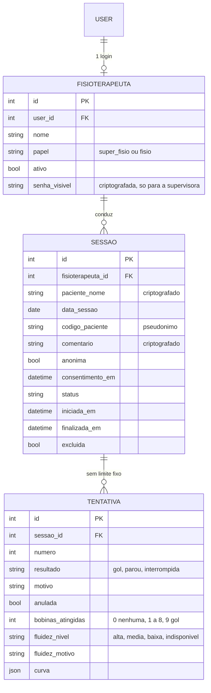

# Escopo PBL — ESME (Estimulador Somatomotor Eletromagnético)

> **Última atualização:** 25/10/2026 · **Versão:** 0.9
> **Legenda:** ✅ feito / confirmado · 🟡 proposta (aguardando OK) · 🔧 depende das placas reais ou de teste · ⬜ a fazer
>
> **Como ler este arquivo:** as seções 1 a 13 descrevem o projeto **como está hoje**. As seções 14 a 17 são o registro das etapas anteriores (v0.3 a v0.5.2); quando divergirem das seções 1 a 13, vale o que está aqui. As seções 18 a 22 trazem o que foi feito depois (v0.6 a v0.9).

---

## 0. Estado atual em uma tabela

| Parte | Estado |
|---|---|
| Site (Django): login, Início, Nova sessão, Espera da mesa, Sessão, Detalhe, Histórico, Relatório (PDF) e CSV, Configurações das placas, Equipe, Sobre nós | ✅ Funciona. **Testado só com dados simulados** (`tools/simular_placas.py`) |
| TCLE e sessão anônima | ✅ Funciona (seção 18) |
| Equipe (só supervisora) e isolamento do histórico | ✅ Funciona (seção 19) |
| Firmware (Wi-Fi, protocolo serial v1, anúncio do IP) | 🔧 Escrito, mas **testado só no computador**, ainda não nas placas (seção 20) |
| Formato dos pacotes da **mesa** | 🔧 Provisório, aguardando o `formato-pacote-mesa.md` do Sandro |
| Sketch real do **batedor** (MPU-6050) | 🔧 Só existe um sketch de teste de conexão |
| Botões físicos da mesa (nova sessão, nova tentativa) | ⬜ Faltam os pinos e a máquina de estados no firmware |
| Limites da **fluidez** (1 pico = alta, 2 = média, 3+ = baixa) | 🔧 Provisórios; só se ajustam com gravações reais |
| Atraso do Wi-Fi × leitura das bobinas | 🔧 Precisa de teste com a mesa montada (condição 13 do Sandro) |
| Chaves de criptografia e backup | ⬜ Trocar as chaves antes de usar dados reais (seção 22) |

---

## 1. Visão geral

✅ Tecnologia (hardware + software) que ajuda terapeutas a **monitorar e avaliar de forma objetiva e quantitativa** a evolução motora de pacientes com sequelas nos membros superiores após AVC, usando **gamificação**.

✅ **Jogo:** air hockey adaptado. O paciente empurra o disco com o **batedor** por cima de 8 bobinas até o **gol** (76 cm). Tema visual: um alien na Terra que o paciente joga de volta ao planeta dele.

✅ **Origem do nome:** ESME é o apelido de **Esmeralda**, mãe de um integrante do grupo, cuja brincadeira de passar uma bolinha de guardanapo inspirou o jogo, e a sigla de Estimulador SomatoMotor Eletromagnético.

✅ **Hardware:** **mesa** com ESP32 (8 bobinas + gol, placar, 2 botões) e **batedor** sem fio com ESP8266 + sensor MPU-6050. Requisito do PBL: **não é vestível**.

✅ **Software:** site que roda **localmente** no notebook da clínica, usado **só pelas terapeutas**. Tela (HTML + CSS + JS) escrita pela Ana; programa (Django) feito com o Sandro. Gera **relatório em PDF** (pelo "Salvar como PDF" do navegador) e **CSV**.

✅ **Indicadores:** só **alcance** e **fluidez**. São indicadores de apoio e **não têm validação clínica**.

---

## 2. Perfis de acesso

| Perfil | Quem é | O que pode |
|---|---|---|
| ✅ **Superadmin** | O grupo (donos) | Tudo, pelo `/admin` do Django |
| ✅ **Super fisio (supervisora)** | Chefe das fisios | Mesmo login das fisios + página **Equipe** (criar perfis de fisioterapeuta, ver/definir senha, desativar, excluir) · vê **todas** as sessões no histórico |
| ✅ **Fisio** | Demais terapeutas | Cria sessões · vê só as sessões **dos próprios pacientes** · não vê a Equipe · não exclui sessões |
| ✅ **Paciente** | — | Sem acesso ao site |

✅ Logins criados pela supervisora na página Equipe (a supervisora **digita** a senha), **sem e-mail e sem recuperação de senha**. Só perfis de **fisioterapeuta** são criados pela página; perfis de **supervisora** só pelo `/admin`.

✅ Permissões em uma função só: `eh_gestor(user)` (superadmin ou super fisio ativa) e `Sessao.objects.visiveis_para(user)` (fisio → só as dela; gestor → todas). Valem para a lista do Histórico, para abrir a sessão, para o relatório, para o CSV e para as sugestões de nome.

---

## 3. Fluxo de uso da fisio

| # | Passo | Estado |
|---|---|---|
| 1 | Liga a **mesa** e o **batedor** na energia (o Wi-Fi já foi gravado nas placas em Configurações) | 🔧 depende das placas |
| 2 | Abre o site no notebook (`python manage.py runserver`, endereço `http://127.0.0.1:8000`) | ✅ (atalho "ESME" na área de trabalho ⬜) |
| 3 | **Login:** lista de nomes (só perfis ativos) + senha | ✅ |
| 4 | **Início:** Nova sessão · Histórico · (Equipe, só supervisora) · Sair. Barra no canto superior direito: Início · Configurações · Sobre nós | ✅ |
| 5 | **Nova sessão:** nome do paciente, data dd/mm/aaaa e a caixa do **TCLE** (seção 18) | ✅ |
| 6 | **Espera da mesa:** a terapeuta segura "nova sessão" na mesa por 3 s; a tela segue sozinha | ✅ simulador · 🔧 mesa real |
| 7 | **Sessão:** cada tentativa aparece com alcance e fluidez; "nova tentativa" na mesa arma a seguinte | ✅ simulador |
| 8 | **Anular / Desfazer** qualquer tentativa (reversível, fora dos totais e do PDF) | ✅ |
| 9 | **Comentário** opcional (criptografado) e **Detalhes** com a curva de velocidade | ✅ |
| 10 | **Encerrar sessão** → **Exportar PDF** ou **Baixar CSV** | ✅ |
| 11 | **Histórico:** buscar, filtrar por data, abrir, PDF, CSV | ✅ |

---

## 4. Páginas do site

| Rota | Página | Quem acessa |
|---|---|---|
| `/accounts/login/` | Lista de nomes + senha | Todos |
| `/` | Início | Logados |
| `/sessao/nova/` | Nome, data, TCLE, sinais da mesa e do batedor | Logados |
| `/sessao/espera/` | Espera pelo aperto de 3 s na mesa | Logados |
| `/sessao/` | Sessão em andamento / modo leitura | Dona da sessão e gestores |
| `/sessao/<id>/relatorio/` | Relatório para "Salvar como PDF" | Dona da sessão e gestores |
| `/sessao/<id>/exportar.csv` | CSV da sessão | Dona da sessão e gestores |
| `/historico/` | Lista de sessões | Fisio: só as suas · Super fisio: todas |
| `/configuracoes/` | Gravar o Wi-Fi nas placas (4 passos) · sair da conta | Logados |
| `/sobre/` | Quem somos · De onde veio o ESME · Termos de uso · Como ler os indicadores | Logados |
| `/equipe/`, `/equipe/novo/`, `/equipe/<id>/` (+ `senha/`, `ativo/`, `excluir/`) | Gestão da equipe | **Só super fisio** (outras contas voltam ao Início) |
| `/admin/` | Painel do Django | Só superadmin |

**Rotas internas (JSON):** `/api/estado/` (a tela pergunta a cada ~0,5 s) e `/api/comando/` (anular, restaurar, encerrar, comentário, abrir sessão do histórico etc.).

✅ A sessão do login expira ao fechar o navegador. Senha mínima de 6 caracteres (6 a 64 ao criar perfil pela Equipe).

---

## 5. Regras do jogo

✅ **Sessão:** conjunto de tentativas de um paciente no mesmo atendimento, **sem limite fixo** de tentativas (modelo do Sandro; antes eram 5).
✅ **Só inicia com a mesa conectada.** Sem batedor, a sessão roda **sem fluidez** ("a fluidez não será registrada"). Sem sinal = mais de 2 s sem pacotes.
✅ **Resultado da tentativa:** **Gol** (disco chegou a 76 cm) · **Parou** (cruzou alguma bobina e ficou 3 s sem avançar) · **Interrompida** (cortada: nova tentativa antes do fim, nova sessão ou mesa que reiniciou).
✅ **Alcance:** bobina mais alta cruzada, em cm: 20, 27, 34, 41, 48, 55, 62, 69, gol 76. Mostra "48 cm (bobina 5)", "76 cm (gol)" ou "nenhum".
✅ **Botões da mesa:** *nova sessão* (segurar 3 s) e *nova tentativa* (aperto curto). A sessão só existe depois do aperto de 3 s.
✅ **Anular** em vez de descartar: reversível, a tentativa fica cinza, sai dos totais e do PDF.
✅ **Sessão sem tentativas não é salva.** Sessão aberta quando o programa fecha fica "Interrompida" no Histórico e pode ser encerrada.

---

## 6. Arquitetura

```
 Batedor (ESP8266 + MPU-6050) ── Wi-Fi, UDP 4210 ──┐
 Mesa (ESP32: 8 bobinas + gol, placar, botões) ── UDP 4212 ──┼──► Notebook da clínica
        ▲                                                     │     Django (um processo só)
        └── anúncio do IP do notebook (UDP 4200, 1x/s) ◄──────┘     estado na memória + SQLite
                                                                        ▲
                                                     Navegador em http://127.0.0.1:8000
```

✅ **Decisões:**
- **Placas sem fio, por UDP** no Wi-Fi 2,4 GHz da clínica (ou hotspot). O **USB só serve para gravar o Wi-Fi** nas placas (Configurações). A ideia de ligar por cabo serial caiu.
- **Django é o programa:** o navegador não recebe UDP, então o Django ouve as placas (`receptor.py`) e guarda o estado na memória (`estado.py`). Por isso deve rodar **um processo só** (runserver ou 1 worker).
- **Tela ao vivo:** a página consulta `/api/estado/` a cada ~0,5 s (sem WebSocket). Trocar por WebSocket depois muda só o `dados.js`.
- **A tela não calcula nada:** alcance, fluidez e resumo vêm do back; todo texto fica em `textos.js`.
- **Banco:** SQLite (`db.sqlite3`), só neste notebook. Nada vai para a nuvem; o servidor atende só `127.0.0.1`.
- **Anúncio do IP:** o notebook avisa o próprio IP em broadcast (UDP 4200) uma vez por segundo; cada placa usa o remetente como destino. O IP gravado pelo USB é só reserva.
- **Bibliotecas:** Django, `cryptography`, `pyserial` (gravar as placas), `psutil` (listar as redes do notebook).

🔧 **Pendências do hardware:** posição dos pinos dos botões · sketch real do batedor · atraso do Wi-Fi × bobinas · liberar UDP 4200, 4210 e 4212 no firewall do Windows (inclusive em rede pública).

---

## 7. Comunicação com as placas

- **Mesa → notebook (UDP 4212):** o teste atual manda um pacote de 8 bytes (`<II`) a cada 100 ms, só como sinal de vida. O formato aprovado em 19/10 (todo pacote leva o estado inteiro + os eventos dos últimos 2 s: bobina, gol, fim) está em `terapia/protocolo.py` como **proposta** e será substituído pelo `formato-pacote-mesa.md`. 🔧
- **Batedor → notebook (UDP 4210):** amostras do MPU-6050 no formato do Anexo A.4 do escopo do Sandro. O sketch atual só envia pacotes vazios para testar a conexão. 🔧
- **Anúncio (UDP 4200):** `ESME-IP;1;<ip_do_notebook>;4212;4210`.
- **Gravar o Wi-Fi (USB, 115200 bauds):** protocolo serial v1, descrito em `protocolo-serial.md` (`ESME?` → `ESME;MESA;1.0`; `CFG;1;<ssid_b64>;<senha_b64>;<ip>` → `OK;WIFI;<ip>` ou `ERRO;<CODIGO>`). A senha do Wi-Fi não é guardada no notebook.

---

## 8. Banco de dados

✅ **Não existe tabela de paciente.** Na Nova sessão a terapeuta digita nome e data. O nome é **criptografado** (Fernet) e as listas mostram só o **código do paciente** (`P-XXXXXX`, HMAC com outra chave).



🟡 **Limpeza pendente:** `EventoBobina`, `Feedback` e os campos antigos de velocidade/aceleração ainda existem no `models.py` (da versão 0.2) e não fazem parte do que a tela mostra.

⚠️ **Privacidade, sem exagero:** o nome do paciente continua no banco, mas **criptografado**; quem copiar o `db.sqlite3` sem a chave não o lê. As sessões **anônimas** (TCLE não marcado) não guardam nome, data nem código e são apagadas ao fechar (seção 18). A **senha das fisios** é guardada de duas formas: hash do Django (para o login) e uma cópia **criptografada reversível** (`senha_visivel`), só para a supervisora poder consultá-la. É uma troca consciente de segurança por praticidade, pedida pela equipe.

---

## 9. Relatório (PDF) e CSV

✅ A página `/sessao/<id>/relatorio/` tem CSS de impressão (A4) e o botão "Salvar como PDF / Imprimir". 1ª página: cabeçalho, paciente (código), data, início/fim/duração, fisio, resumo, tabela, comentário; depois uma ficha por tentativa com a curva, três por página. Tentativas anuladas ficam de fora. Rodapé: "Indicador de apoio; não substitui a avaliação clínica."
✅ O nome do paciente só entra se a terapeuta marcar "Incluir o nome do paciente". O CSV (separador `;`, com BOM para o Excel) nunca leva nome nem comentário.
✅ Sessão anônima: relatório "Anônimo / 00/00/0000", sem código, data nem hora; CSV `esme_anonimo.csv`.
✅ **O sistema não envia e-mail.** A terapeuta salva o arquivo e envia pelo canal oficial da clínica. Evitar WhatsApp pessoal (LGPD).
🟡 "Baixar PDF" direto do servidor (reportlab) fica para depois, se o "Salvar como PDF" não bastar.

---

## 10. Histórico e armazenamento

✅ O Histórico lista sessões da mais recente para a mais antiga (data e hora, código, tentativas válidas, melhor alcance, situação) com busca por nome ou código e filtro por data. A supervisora vê todas, com a coluna Fisioterapeuta. Sessões anônimas não entram.
✅ O programa guarda a **curva de velocidade** de cada tentativa, não as amostras brutas do acelerômetro. O peso é pequeno (algumas centenas de KB por sessão).
⬜ **Backup:** o programa **não faz backup**. Copiar `db.sqlite3` **e** a pasta `dados_privados\` (as duas chaves) para um lugar separado e protegido. Sem a chave, nomes e comentários não abrem.

---

## 11. Ambiente e estrutura

✅ Windows · Anaconda (ambiente `siteESME`, Python 3.12) · VS Code · Django 6.1.2 · repositório Git (branch atual `lalala8`).

```
ESME/
├── core/                    settings.py, urls.py
├── terapia/
│   ├── models.py  views.py  urls.py  forms.py  admin.py  apps.py
│   ├── estado.py            programa: sessões, tentativas, comandos (estado em memória)
│   ├── receptor.py          ouve as placas (UDP 4212 e 4210)
│   ├── protocolo.py         formato dos pacotes (mesa ainda provisório)
│   ├── fluidez.py           cálculo da fluidez (limites provisórios)
│   ├── placas.py  rede.py  anuncio.py     Configurações das placas e anúncio do IP
│   ├── equipe.py            criar, ativar/desativar e excluir perfis
│   ├── campos.py            criptografia (Fernet) e código do paciente (HMAC)
│   ├── exportar.py          relatório e CSV
│   ├── templatetags/        esme_extras.py ()  (o __init__.py fica VAZIO)
│   ├── migrations/
│   └── static/terapia/      css/, js/, img/
├── templates/               base.html, registration/login.html, terapia/*.html
├── firmware/                mesa_esme/, batedor_esme/ (cada um com esme_config.h)
├── tools/                   simular_placas.py, diagnostico.py
├── dados_privados/          chaves e rede configurada  (NÃO vai pro Git)
├── db.sqlite3               (NÃO vai pro Git)
├── Escopo_PBL.md            este arquivo
├── protocolo-serial.md
├── README.md  requirements.txt
└── .gitignore               dados_privados/, db.sqlite3, __pycache__/
```

---

## 12. Roadmap

- [x] Login, Início, navbar
- [x] Nova sessão (com TCLE), Espera da mesa, Sessão, Detalhe, Anular
- [x] Comentário, relatório (PDF), CSV, Histórico
- [x] Configurações das placas (rede, mesa, batedor, conferir)
- [x] Equipe (supervisora) e isolamento do histórico por fisio
- [x] Sobre nós (textos)
- [x] Firmware com Wi-Fi e anúncio do IP (testado só no computador)
- [ ] 🔧 Gravar e testar o firmware **nas placas reais**
- [ ] 🔧 Formato de pacote da mesa definitivo (`formato-pacote-mesa.md`) e botões físicos
- [ ] 🔧 Sketch real do batedor (MPU-6050) e **gravações reais** para ajustar a fluidez
- [ ] 🔧 Teste de atraso do Wi-Fi × leitura das bobinas, firewall
- [ ] ⬜ Trocar as chaves de criptografia, backup, BitLocker
- [ ] ⬜ Revisão do texto dos Termos (prazo de guarda, COFFITO) com o orientador; PDF do TCLE
- [ ] ⬜ Atalho "ESME" na área de trabalho, testes com voluntários e depois com as terapeutas
- [ ] ⬜ Limpar `EventoBobina`, `Feedback` e campos antigos do `models.py`

---

## 13. Histórico de alterações

| Data | Versão | O que mudou |
|---|---|---|
| 13/10/2026 | 0.1 | Criação do escopo · `models.py` reescrito · perfis, regras do jogo, arquitetura e API |
| 13/10/2026 | 0.2 | **Sem tabela de paciente** (nome + data digitados na sessão, só iniciais nas listas) · fluxo da fisio e mapa de páginas · arquitetura trocada para **USB serial** (Wi-Fi opcional) · protocolo em JSON por linha · PDF por impressão do navegador · decisão sobre histórico e armazenamento · roadmap reorganizado |
| 15/10/2026 | 0.3 | Login e home funcionando · **front da sessão com back em espera** (páginas Nova sessão e Sessão, módulo de dados de demonstração, painel de simulação) · alinhamento com o escopo do Sandro (seção 14): transporte, indicadores, Anular, PDF gerado pelo programa |
| 16/10/2026 | 0.4 | **Navbar** (Sobre e Configurações) · página **Sobre** com abas (Quem somos, Termos, Como ler os indicadores) · página das tentativas simplificada (paciente, mesa, batedor e tabela) · coluna Resultado removida · decisão sobre o PDF |
| 22/10/2026 | 0.5 | **Nova sessão + Espera da mesa com circuito real**: back sem simulador (receptor UDP 4212/4210 dentro do Django, estado em memória, API `/api/estado/` e `/api/comando/`) · indicadores Mesa/Batedor · nome do paciente **criptografado** no banco · parte da v0.4 (navbar, Sobre, Configurações) fora desta base |
| 22/10/2026 | 0.5.1 | **Sessão**: fluidez calculada em segundo plano ("Calculando fluidez…" até ~3 s, sem travar as próximas tentativas) · curva no Detalhe com aviso centralizado enquanto calcula · tentativa anulada em cinza escuro com **Desfazer** · topo da Sessão reorganizado (sem sobreposição com a logo) |
| 22/10/2026 | 0.5.2 | **Comentário, exportação, histórico e pseudonimização**: comentário opcional da terapeuta (criptografado) · código do paciente `P-XXXXXX` (HMAC com chave própria) · relatório para "Salvar como PDF" e CSV · página **Histórico** (buscar, filtrar por data, abrir, PDF, CSV) · sessão interrompida pode ser encerrada |
| 22–23/10/2026 | 0.6 | **Configurações das placas** (rede, mesa, batedor, conferir: `rede.py`, `placas.py`, `anuncio.py`) · navbar e Sobre (casca) · **firmware** com Wi-Fi e protocolo serial v1 (`esme_config.h`, `mesa_esme.ino`, `batedor_esme.ino`) · anúncio do IP (UDP 4200) |
| 23/10/2026 | 0.7 | Barra de navegação no **canto superior direito** · **TCLE virtual** e **sessão anônima** · sinais da mesa e do batedor no canto superior direito da Sessão |
| 23/10/2026 | 0.8 | **Equipe** (só supervisora): lista com bolinha verde/cinza, novo perfil, senha visível, desativar/reativar e excluir com confirmação · histórico isolado por fisio (supervisora vê tudo) |
| 25/10/2026 | 0.9 | **Sobre nós** com os textos (Quem somos, De onde veio o ESME, Termos de uso, Como ler os indicadores) · campo de nome do Novo perfil · **escopo reorganizado** (seções 0 a 13 refeitas para o estado atual) · README e `requirements.txt` |


---

## 14. Registro: front da sessão com back em espera (v0.3)

✅ **Feito:** login (lista de nomes + senha) e home.
✅ **Agora:** páginas **Nova sessão** (nome do paciente + data digitada) e **Sessão** (resumo, lista de tentativas, Detalhe com curva, Anular/Restaurar, Encerrar). Enquanto não há circuito, um **módulo de dados de demonstração** (`dados.js`) faz o papel do programa; o resto da tela só conhece `iniciar`, `assinar`, `enviarComando` e `obterCurva`. Para trocar pelo back real, só esse arquivo muda.

**O que a tela mostra** (segue o escopo do Sandro, seções 7.4 a 7.9)
- Resumo: tentativas válidas · gols · melhor alcance · fluidez (alta / média / baixa / indisponível). Anuladas e a tentativa em curso não entram.
- Lista (mais recente em cima): Nº · Resultado (Gol, Parou, Interrompida) · Alcance ("48 cm (bobina 5)", "76 cm (gol)", "nenhum") · Fluidez · Ações (Detalhes, Anular/Restaurar).
- Sem pontos, sem velocidade em número, sem dor. Só **alcance** e **fluidez**.
- Cabeçalho reduzido durante a sessão (Mesa, Batedor, paciente, hora de início); completo só depois de encerrar.
- A tela **não calcula nada** e todo texto fica em `textos.js`.

**Divergências entre este escopo (v0.2) e o do Sandro — a alinhar com o grupo**

| Tema | Escopo v0.2 (nosso) | Escopo do Sandro | Decisão provisória |
|---|---|---|---|
| Ligação das placas | Cabo USB (serial) | UDP pelo Wi-Fi da clínica; mesa (ESP32) e batedor sem fio (ESP8266); USB só para gravar o Wi-Fi | **Sandro** (a ideia do USB cai) |
| Back-end | Django | Programa Python único (.exe) com WebSocket + HTTP; tela estática | ✅ **Django continua** (o HTML estático do Sandro é só referência) |
| Indicadores | Velocidade, aceleração, dor | Só alcance e fluidez | **Sandro** (a tela já segue) |
| Descartar | Só tentativa com 0 bobinas, apagando | **Anular** qualquer tentativa, reversível, fora dos totais e do PDF | **Sandro** |
| Botões da mesa | 1 botão | Nova sessão (segurar 3 s) e nova tentativa (aperto curto) | **Sandro** |
| Bobinas | 9 ou 16? | 8 bobinas + gol (76 cm) | **Sandro** (pendência resolvida) |
| Data da sessão | Vem com hoje | Caixa vazia, a fisio digita dd/mm/aaaa | **Sandro** |
| PDF | Impressão do navegador | O programa gera e salva em Documentos | ✅ Precisa poder ser **salvo no computador**; no Django o navegador baixa o arquivo (seção 15) |
| Perfis | Superadmin, super fisio, fisio | Administrador e fisioterapeutas; cada conta vê só as próprias sessões | 🟡 A alinhar (super fisio vê tudo?) |
| Sessão do login | Expira em 30 min | Sem bloqueio por inatividade | 🟡 A alinhar |

✅ **Decidido:** seguir o plano do Sandro (telas, indicadores, regras) mas continuar com Django. A tela pega dados só de `dados.js`, então o back real entra depois sem refazer a tela.

**Ajustes de `models.py` quando o back for integrado** (hoje fora do caminho):
`Tentativa.anulada` · `resultado` = gol / parou / interrompida (+ motivo) · alcance como bobina atingida · `fluidez` (nível + motivo) · curva de velocidade (pontos) · remover `Feedback` e as métricas de velocidade/aceleração · `EventoBobina` só se o back precisar guardar eventos brutos.

**Roadmap (atualizado)**
- [x] Fase 1 — Login e home
- [x] Fase 3a — Nova sessão e Sessão com dados de demonstração
- [ ] Fase 3b — Histórico de sessões (lista com busca por nome e data, abrir sessão antiga)
- [ ] Fase 2 — Equipe (adicionar/desativar contas)
- [ ] Fase 4 — Ligar ao back real (WebSocket/HTTP) quando o contrato estiver fechado
- [ ] Fase 5 — PDF, Configurar placas e Diagnóstico (back)


---

## 15. Navegação, Sobre e página das tentativas (v0.4)

✅ **Navbar simples** (logo à esquerda; **Sobre** e **Configurações** à direita), em todas as páginas menos no login. Fica em `templates/componentes/navbar.html`.

✅ **Sobre** (aberto a qualquer pessoa, mesmo sem login), com 3 abas: **Quem somos**, **Termos** e **Como ler os indicadores**.
- *Como ler os indicadores*: texto aprovado (alcance + tabela das bobinas, fluidez + duas curvas de exemplo, aviso "Indicador de apoio; não substitui a avaliação clínica."). As posições das bobinas vêm de `views.py`.
- 🟡 *Quem somos* e *Termos* estão como **rascunho** e precisam ser escritos pelo grupo e revisados pelo orientador (prazo de guarda, COFFITO, quem apaga dados).

✅ **Configurações**: por enquanto só uma página "em construção" com o que virá (Equipe, Configurar placas, Diagnóstico) e o botão **Sair da conta**.

✅ **Página das tentativas** (abre direto depois de Nova sessão):
- Topo: **Paciente: [nome]** · **Mesa** e **Batedor** com bolinha **verde = conectada** e **vermelha = sem sinal** (e o texto, para não depender só da cor).
- Tabela: **Tentativa · Alcance · Fluidez · Ações**. Sem coluna *Resultado*.
- Ações: **Detalhes** (gráfico de velocidade como no protótipo do Sandro, sem "Resultado"), **Anular** e **Restaurar**.
- Por enquanto **fora** da página (voltam depois): cartões de resumo, Encerrar sessão, Gerar PDF e a espera pelo aperto de 3 s na mesa.

**PDF — decisão (precisa poder ser salvo no computador)**
1. *Agora (sem back):* página do relatório com CSS de impressão e botão "Salvar como PDF" (o navegador abre "Salvar como…" e o arquivo vai para a pasta que a fisio escolher).
2. *Com o back:* o Django gera o PDF (biblioteca `reportlab`, só Python) e o navegador **baixa o arquivo** (pasta Downloads ou janela de salvar). É o equivalente ao "salvo em Documentos" do Sandro. Se quiserem a pasta fixa, o Django também pode gravar uma cópia em `Documentos\Sessões`.
3. Em qualquer caso o PDF não traz a tentativa anulada e repete o aviso "Indicador de apoio; não substitui a avaliação clínica."

**Roadmap (atualizado)**
- [x] Login, home, Nova sessão
- [x] Navbar, Sobre, Configurações (casca)
- [x] Página das tentativas com dados de demonstração
- [ ] Texto final de Quem somos e Termos (grupo + orientador)
- [ ] Resumo, Encerrar sessão e relatório/PDF
- [ ] Histórico de sessões · Equipe · espera pela mesa
- [ ] Ligar ao back real

---

## 16. Nova sessão com o circuito real (v0.5)

Base: arquivos da v0.3 (login, home), sem navbar/Sobre/Configurações da v0.4. Visual lúdico mantido; funções do protótipo do Sandro (`esqueleto-tela-esme.html`) aplicadas só à **Nova sessão** e à **Espera da mesa**.

**Decisões**
- **Sem simulador na tela.** A tela só mostra o que o programa informa; sem placas ligadas, Mesa e Batedor ficam "Sem sinal". Para testar o caminho inteiro existe um script **de desenvolvimento** (`tools/simular_placas.py`) que manda pacotes UDP no formato real.
- **Programa = o próprio Django.** O navegador não recebe UDP, então o Django ouve as placas (`receptor.py`: mesa **4212**, batedor **4210**, só recebe) e guarda o estado na memória (`estado.py`). A tela pergunta o estado a cada 0,5 s (`GET /api/estado/`) e manda comandos (`POST /api/comando/`). Trocar por WebSocket depois muda só o `dados.js`.
- **A tela segue o campo `tela`** do estado: `sem_sessao` (formulário) · `aguardando_mesa` (espera) · `sessao_em_andamento` (vai para a Sessão). F5 na espera continua na espera.
- **Sessão só existe depois do aperto de 3 s** em "nova sessão" na mesa (contador de sessão do batimento sobe). A hora do aperto é a hora de início. Aperto antes da tela de espera não conta; mesa que reinicia **não** abre sessão.
- **Sem sinal** = mais de 2 s sem pacotes (cabeçalho: "nenhuma tentativa será registrada" / "a fluidez não será registrada"). Faixa "Sem conexão com o programa" se a página perder o Django.
- **Nome criptografado agora** (e não depois): `paciente_nome` usa Fernet (`campos.py`), chave fora do banco e do Git (`dados_privados/chave_esme.key` ou variável `ESME_CHAVE`). Sugestões de nome são filtradas no Python (por fisio, sem acento) porque o banco guarda o nome embaralhado. Fazer agora é barato (não há dados); depois exigiria migrar tudo.
- Sessão sem tentativas não é salva ao encerrar (regra do Sandro). Sessão em andamento reabre direto na Sessão.

**Confirmado em 22/10/2026**
- **Back-end = Django** (confirmado pela Ana; o servidor próprio com SQLite da Etapa 2 do Sandro não é o caminho do site).
- **A tela é escrita pela Ana** (regra do escopo: tela feita por pessoa do grupo).
- **Formato dos pacotes da mesa aprovado em 19/10 (Sandro):** sem batimento separado; a cada 100 ms todo pacote leva o estado inteiro (`estado`, `contador_sessao`, `contador_tentativas`, `bobina_max`, `motivo_fim`) + os eventos dos últimos 2 s. Eventos: bobina = tipo 2 (1 a 8), gol = tipo 3, fim = tipo 4 com motivo (gol, parou, nova tentativa, nova sessão). Detalhe byte a byte em `formato-pacote-mesa.md` (a anexar) → substitui a proposta do `protocolo.py`.

**Tentativas (22/10/2026)**
- `estado.py` monta as tentativas a partir dos eventos da mesa (1 iniciada · 2 bobina · 3 gol · 4 fim): `aguardando_disco → em_andamento → concluida`; resultado `gol | parou | interrompida` (+ motivo `nova_tentativa | nova_sessao | mesa_reiniciou`). Alcance = bobina mais alta cruzada (bobina pulada é aceita); `Tentativa.bobinas_atingidas`: 0 nenhuma, 1–8 bobina, 9 gol.
- Eventos repetidos (janela de 2 s) são descartados por `ev_id`; eventos que chegam junto do aperto de 3 s são de antes da sessão e não contam; tentativa em curso quando a mesa reinicia fecha como interrompida.
- Comandos: `anular`, `restaurar` (também depois de encerrar), `encerrar_sessao` (disco rolando → "encerrando" até fechar; aguardando disco é descartada; sessão sem tentativas não é salva), `fechar_leitura`.
- Resumo calculado no back (tentativas válidas, gols, melhor alcance, fluidez), sem as anuladas. Fluidez: ver o bloco "Sessão, fluidez em segundo plano e Detalhes" abaixo.
**Sessão, fluidez em segundo plano e Detalhes (22/10/2026, à noite)**
- **Fluidez calculada em segundo plano** (`fluidez.py`, thread própria em `estado.py`): ao fim da tentativa ela fica `calculando` ("Calculando fluidez…") até chegarem as amostras do batedor que cobrem o fim, ou 3 s (regra do Sandro, 9.2); a terapeuta **não espera**: a próxima tentativa já roda enquanto a anterior calcula. Estados da tentativa: `aguardando_disco → em_andamento → calculando → concluida`; o resumo traz `fluidez.calculando` (quantas ainda esperam).
- **Como calcula:** amostras do começo da tentativa até o impacto (sensor saturando, ≥ 14 g) · repouso de referência = primeiros 0,3 s parados; senão o último repouso da sessão; senão "indisponível — sem repouso de referência" · aceleração sem o repouso, projetada no eixo do movimento, integral por trapézio = velocidade · número de picos (sobressaindo ≥ 10% do maior): 1 = alta, 2 = média, 3 ou mais = baixa. Sem amostras / sem movimento: "indisponível — sem dados do batedor". **Limites provisórios**: só se ajustam com gravações reais do batedor (em aberto no escopo do Sandro).
- **Curva do Detalhe:** gravada em `Tentativa.curva`; comando `obter_curva`; escala igual em todas as tentativas da sessão (compara-se a forma); sem números no eixo vertical. Enquanto calcula, o quadro mostra no meio "Calculando o gráfico…".
- **Anular:** a linha fica **cinza escura**, mostra a etiqueta "anulada" e só oferece o botão **Desfazer** (comando `restaurar`); funciona também depois de encerrar.
- **Topo da Sessão** com logo, paciente, data, início (e fim, se encerrada) e os sinais da mesa e do batedor, cada um na sua faixa (a barra do site não aparece na Sessão, para nada ficar por cima da logo). Botão **Encerrar sessão** → "Encerrando…" se o disco ainda rola → "Fechar" no modo leitura.
- **Logo da Sessão = a do cabeçalho do site** (a mesma da Início; clicar nela volta para o Início); a Sessão não desenha logo própria.
- **Cartão "O que fazer agora"** (cartões de altura compacta): **uma frase só**, sem numeração, que muda sozinha — sem tentativa aberta: "Posicione o disco e aperte nova tentativa na mesa" · aguardando disco: "Peça ao paciente que bata no disco" · disco rolando (ou encerrando): "Espere a jogada acabar…" · sessão encerrada: "Sessão encerrada. Você ainda pode anular tentativas." Uma linha reservada abaixo mostra o aviso de sem sinal da mesa/batedor, então nada na página se mexe quando a conexão cai.
- **Fluidez ao encerrar:** embaixo, perto do botão **Fechar**, uma caixinha para cada tipo (alta · média · baixa · indisponível; + "calculando" se ainda houver); durante o jogo a fluidez só aparece na tabela.
- Nova sessão / Espera: o bloco de sinais tem estilo próprio em `nova_sessao.css` (não depende do `sessao.css`).
- **Erros visíveis:** banco desatualizado (faltou `migrate`) devolve o código `banco_desatualizado` e a tela mostra o que fazer; faixa vermelha "scripts não carregaram" fica na tela até o JS rodar.
- Simulador (`tools/simular_placas.py --tentativas`) agora também manda o batedor se mexendo (1 tacada = alta, 2 = média, 3–4 = baixa) para ver os três níveis.

- `Tentativa.numero` sem limite de 5. Campos novos: `resultado`, `motivo`, `anulada`, `fluidez_nivel`, `fluidez_motivo`, `curva` (rodar `makemigrations` e `migrate`).

**Em aberto (depende do Sandro / Bloco 6)**
- **Formato dos pacotes da mesa.** O do batedor já está no Anexo A.4. O da mesa é **proposta** em `protocolo.py` (`<BBHHHII`); o teste atual do circuito (8 bytes) só serve como sinal de vida, **sem** detectar o aperto de 3 s.
- Anúncio do IP do notebook na rede (1 por segundo) e a porta usada.
- Chave: guardar uma **cópia** da chave; opcional proteger com DPAPI do Windows (como o Sandro prevê) e ligar o BitLocker.
- O processo do Django deve ser **um só** (runserver ou 1 worker): o estado fica na memória.
- `Tentativa.numero` ainda limita a 5 e `Feedback` ainda existe: ajustar na etapa da Sessão (modelo do Sandro: sem limite fixo, com Anular, resultado, fluidez).


---

## 17. Comentário, exportação, histórico e pseudonimização (v0.5.2)

**Pseudonimização**
- Cada sessão guarda um **código de paciente** `P-` + 6 símbolos (`ABCDEFGHJKMNPQRSTUVWXYZ23456789`, sem 0/O/1/I/L). É um **HMAC-SHA256** do nome normalizado (sem acento, minúsculo, espaços juntos) com o id da fisio, usando uma **chave própria** (`dados_privados/chave_pseudonimo.key` ou variável `ESME_CHAVE_PSEUDO`), diferente da chave que criptografa o nome. Mesmo nome na mesma conta = mesmo código (dá para acompanhar a evolução sem mostrar o nome); outra conta gera outro código para o mesmo nome. Sem a chave, o código não leva de volta ao nome.
- O **nome continua criptografado** no banco (só a terapeuta precisa ver). Códigos de sessões antigas (sem código) são criados na primeira vez que aparecem.
- **Homônimos** (duas pessoas com o mesmo nome na mesma conta) recebem o mesmo código. Limite conhecido; se ficar um problema, a Nova sessão ganha um campo de identificação extra.
- **O que sai do programa leva só o código:** lista do Histórico (nome só com "Mostrar nomes"), CSV (nunca leva nome nem comentário), relatório (o nome só entra se a terapeuta marcar "Incluir o nome do paciente").

**Comentário da terapeuta**
- Opcional, até 2000 letras, na própria página da Sessão (durante, depois de encerrar e quando a sessão é aberta pelo Histórico). Salva sozinho ~0,8 s depois da última letra ("Salvando…" → "Salvo") e antes de encerrar, fechar ou exportar. Fica **criptografado** (`Sessao.comentario`, `comentario_em`). A dica pede para não escrever o nome do paciente.
- Quem comenta: a dona da sessão. O gestor só lê.

**Exportação**
- Na Sessão encerrada (ou aberta do Histórico): **Exportar PDF** abre `/sessao/<id>/relatorio/` em outra aba, com o botão "Salvar como PDF / Imprimir" (impressão do navegador, A4). 1ª página: cabeçalho, paciente (código), data, início/fim/duração, fisio, resumo, tabela, comentário; depois uma ficha por tentativa com a curva, **três por página**; anuladas ficam de fora; rodapé "Indicador de apoio; não substitui a avaliação clínica." e área em branco para anotações.
- **Baixar CSV** (`/sessao/<id>/exportar.csv`): separador `;`, com BOM (Excel em português), uma linha por tentativa finalizada, com a coluna `anulada`.
- O sistema não envia nada: a terapeuta salva o arquivo e manda pelo canal oficial da clínica.

**Histórico** (`/historico/`)
- Lista, da mais recente para a mais antiga: data e hora · código (ou nome + código) · tentativas válidas · melhor alcance · situação (Concluída / Interrompida, "com comentário") · **Abrir / PDF / CSV**. Busca por nome ou código (digitando) e por data dd/mm/aaaa; "Limpar". Sessão sem tentativas finalizadas não aparece (e a sessão em andamento só entra quando encerrar). O gestor vê as sessões de todas as fisios (coluna Fisioterapeuta).
- **Abrir** mostra a Sessão em modo leitura (Detalhes, Anular/Desfazer, comentário, exportar); "Fechar" volta ao Histórico. Não abre se há sessão em andamento no programa.
- **Sessão interrompida** (programa fechado antes de encerrar): aparece como "Interrompida"; ao abrir há um aviso e o botão **Encerrar sessão**, que só troca a situação para Concluída (hora do fim = última tentativa gravada; sem tentativas, a sessão é apagada).

**Banco / comandos novos**
- `Sessao.codigo_paciente`, `comentario`, `comentario_em` → rodar `makemigrations` e `migrate`.
- Comandos: `salvar_comentario`, `abrir_sessao`, `concluir_interrompida`, `listar_historico`. Rotas: `historico`, `relatorio`, `exportar_csv`.

**Em aberto**
- **Backup das DUAS chaves** (`chave_esme.key` e `chave_pseudonimo.key`) em lugar separado do banco; sem a primeira os nomes e comentários não abrem.
- PDF direto do servidor ("Baixar PDF") fica para depois, se o "Salvar como PDF" do navegador não bastar.
- Exclusão de sessões só pelo admin (Sandro) continua para a etapa do admin.


---

## 18. TCLE virtual e sessão anônima (v0.7)

✅ Na **Nova sessão**, logo abaixo do bloco do nome e da data, fica a caixa do **TCLE** (check grande, texto em branco, sem cartão). Há um link para o PDF do termo se o arquivo `terapia/static/terapia/docs/tcle.pdf` existir (opcional).

- **Marcado:** o paciente declarou ciência de que os dados ficam salvos no histórico, pseudonimizados. A sessão guarda `consentimento_em` e entra no Histórico normalmente.
- **Não marcado (padrão): sessão anônima.** Sem nome, sem data, sem horário e sem código. Não entra no Histórico nem nas sugestões de nome, e é **apagada** quando a terapeuta fecha a leitura, ao sair da conta, ao preparar ou abrir outra sessão e na primeira leitura depois que o programa liga. O relatório mostra "Anônimo / 00/00/0000" e o CSV sai como `esme_anonimo.csv`. A tela mostra um aviso de que a sessão é anônima e não será salva.
- Só o valor `true` conta como consentimento; qualquer outro valor vira sessão anônima.

🟡 O texto final do TCLE e a aprovação pela instituição ainda precisam do orientador.

---

## 19. Equipe (v0.8)

✅ **Só a super fisio vê a página.** Outras contas que digitarem o endereço voltam ao Início, e o botão nem aparece para elas.

- **Lista:** situação (bolinha **verde** = ativa, **cinza** = desativada), nome, perfil, número de sessões e último acesso. Perfis de supervisora aparecem como "gerenciada pelo /admin" e não são alterados pela página.
- **Novo perfil:** a supervisora digita **nome** e **senha** (6 a 64 caracteres, sem espaços). Nome repetido é recusado. Só cria perfil de **fisioterapeuta**.
- **Perfil da terapeuta:** situação, sessões salvas, **senha** escondida até clicar em **Mostrar** (a página não é guardada em cache), **Definir nova senha**, **Desativar / Reativar** e **Excluir**.
- **Desativar:** a terapeuta perde o login e some da lista de login; o histórico dela fica.
- **Excluir** (com confirmação): sem sessões, basta "Sim, excluir". Com sessões, há **duas opções**: "Desativar em vez de excluir" ou "Excluir o perfil e as N sessões" (apaga tudo, sem desfazer).
- **Bloqueios:** não dá para desativar nem excluir quem está com uma sessão aberta no momento.
- **Senha visível:** guardada em `Fisioterapeuta.senha_visivel`, criptografada com a chave do programa. Perfis criados no `/admin` mostram "senha não registrada" até alguém definir uma nova senha pela Equipe. **Trocar a senha pelo `/admin` não atualiza a senha mostrada**; troque sempre pela Equipe.
- Código em `terapia/equipe.py` (criar, definir senha, alternar ativo, excluir) e nas views `equipe*`; migração nova do campo `senha_visivel` (`makemigrations` + `migrate`).

✅ **Isolamento do histórico:** a fisio só vê as sessões que conduziu e a supervisora vê todas. Testado com dados simulados (duas contas), inclusive abrir por endereço, relatório, CSV e sugestões de nome. Se duas terapeutas atendem pacientes com o mesmo nome, cada uma vê só as suas.

---

## 20. Firmware e Configurações das placas (v0.6)

✅ **Configurações (4 passos):** 1. Rede (nome + senha do Wi-Fi; o programa descobre o IP do notebook) → 2. Placa da mesa → 3. Placa do batedor (uma de cada vez, pelo USB; o programa acha a porta sozinho e grava) → 4. Conferir (Mesa e Batedor "Conectada"). Enquanto a configuração não for concluída, o botão Nova sessão fica desativado (chave `ESME_EXIGIR_CONFIGURACAO` do `settings.py`, só para testar com o simulador). A gravação fica bloqueada durante uma sessão. O programa guarda só o nome da rede e o IP em `dados_privados/rede_configurada.json`; a **senha do Wi-Fi não é guardada**.

🔧 **Firmware** (`firmware/mesa_esme/` e `firmware/batedor_esme/`, cada um com o mesmo `esme_config.h`):
- `esmeIniciar()`, `esmeServico()`, `esmeEsperar(ms)` e `esmeEnviar(bytes, n)` cuidam do Wi-Fi, do protocolo serial v1, da memória (EEPROM) e do anúncio de IP.
- A rede só é gravada **depois de conectar com sucesso**; se falhar, volta a anterior. Erros: `REDE_NAO_ENCONTRADA`, `SENHA_INCORRETA`, `TEMPO_ESGOTADO`, `COMANDO_INVALIDO`, `FLASH`.
- `mesa_esme.ino` é o código do colega com marcas `// [ESME]` (o `delay()` virou `esmeEsperar()`); mesa manda o sinal de vida de 8 bytes a cada 100 ms. `batedor_esme.ino` é só um teste de conexão.
- **Testado só no computador, com simulação do hardware.** Falta gravar nas placas, medir o atraso do Wi-Fi contra a leitura das bobinas e escrever os botões e o formato final dos pacotes.

---

## 21. Sobre nós (v0.9)

✅ Página com quatro blocos (feita em `templates/terapia/sobre.html` e `sobre.css`): **Quem somos** (Grupo 3, T3 de Engenharia Biomédica, 4º semestre, objetivo do PBL), **De onde veio o ESME** (a brincadeira com a bolinha de guardanapo, o air hockey e o nome Esmeralda), **Termos de uso** e **Como ler os indicadores**.

- *Termos de uso:* baseado na seção de privacidade do escopo do Sandro e ajustado ao site de hoje: o que o ESME é e não é, dados do paciente (só neste computador, nome criptografado, sessão anônima, nome no PDF só por escolha), contas e acesso (fisio vê só as suas; supervisora vê todas e consulta senhas), responsabilidades (sem backup, cópias fora do site, a clínica define o prazo de guarda).
- *Como ler os indicadores:* alcance com a tabela das bobinas (20 a 69 cm, gol 76 cm), como a tentativa terminou, fluidez com duas curvas de exemplo (um pico = fluido; vários picos = entrecortado), o que significa "indisponível" e o aviso "Indicador de apoio; não substitui a avaliação clínica."
- Hoje a página **exige login** (diverge da seção 15, que previa acesso livre).
- 🟡 O prazo de guarda dos dados e o enquadramento (COFFITO, LGPD) precisam de revisão do orientador.

---

## 22. Pendências e riscos antes de usar com dados reais

**Para ler dados das placas reais**
1. Gravar o firmware nas placas e testar a conexão (Configurações).
2. Receber o `formato-pacote-mesa.md` e ajustar o `protocolo.py`.
3. Escrever o sketch do batedor e a máquina de estados dos botões da mesa.
4. Gravar tacadas reais para ajustar os limites da fluidez.
5. Medir o atraso do Wi-Fi (o Sandro viu rajadas de 130 a 450 ms no hotspot) e liberar UDP 4200, 4210 e 4212 no firewall.
6. Testar com **voluntários saudáveis** antes de pacientes.

**Para guardar dados de pacientes**
1. **Trocar as chaves** de `dados_privados/` (as atuais foram enviadas ao GitHub no commit `f58d1fa` e valem como vazadas) e conferir que o repositório é **privado**.
2. Backup do `db.sqlite3` **e** das duas chaves em lugar separado; BitLocker ligado. Evitar disco com defeito.
3. Aprovação do TCLE pela instituição (e pelo comitê de ética, se exigido) e revisão dos Termos com o orientador.
4. Manter o aviso de que os indicadores não têm validação clínica.

**Decisões conscientes (para o grupo saber)**
- A supervisora consegue ver as senhas das fisios (cópia criptografada reversível), a pedido da equipe.
- O estado fica na memória: um processo só, e uma sessão em andamento se perde se o programa fechar no meio de uma tentativa.